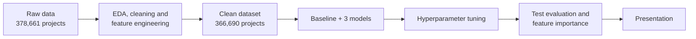

# Will Your Kickstarter Get Funded?

A machine learning project that predicts, **at launch time**, whether a Kickstarter campaign will reach its funding goal. It uses only information a creator knows before the campaign starts: the funding goal, category, country, campaign duration, launch date and time, and the length of the project name.

Kickstarter is all-or-nothing: if a project misses its goal by the deadline, the creator receives nothing. A model that flags a campaign's chances before launch helps creators set realistic goals and helps the platform spot promising projects early.

## Results at a Glance

| | Baseline (always "fail") | **Final model (Gradient Boosting)** |
|---|---|---|
| F1 (successful class) | 0.00 | **0.62** |
| ROC AUC | 0.50 | **0.76** |
| Accuracy | 0.64 | **0.68** |
| Precision / Recall | – | **0.55 / 0.71** |

Scores are on a held-out test set of 73,315 projects that the model never saw during training or tuning. Training and test scores differ by only about 0.01, so the model generalises well and does not overfit.

**What drives success** (permutation importance, drop in ROC AUC):

1. **Funding goal**: by far the strongest signal. Lower goals succeed much more often.
2. **Category**: games, comics and theatre succeed far more often than technology or food.
3. **Campaign duration** and **launch year** come next.
4. Name length and launch hour have a small effect; country, weekday, month and day barely matter.

In practice, what a creator decides about the goal and the type of project matters far more than exactly when the campaign launches.

## Project Workflow



### 1. Data

The [Kickstarter Projects dataset](https://www.kaggle.com/datasets/kemical/kickstarter-projects) (`ks-projects-201801.csv`) with 378,661 projects. The 2016 file is an older snapshot of the same projects and is used only for a comparison check.

### 2. EDA, Cleaning and Preprocessing ([notebook](kickstarter_eda_preprocessing.ipynb))

Every decision in this notebook is backed by a check or a quick model. The main steps:

- **Target:** `successful` → 1, `failed` → 0. Live and undefined projects are removed, suspended projects are dropped, and canceled projects are analysed separately and split into three groups. Successful projects make up about 36% of the data, so the classes are imbalanced.
- **Data leakage:** columns that are only known after the campaign ends (`pledged`, `backers`, `usd pledged`, `usd_pledged_real`) are removed, together with IDs and redundant columns (`currency` is fully explained by `country`, `main_category` by `category`).
- **Joke and test projects** are flagged and the clear cases are removed.
- **Re-posts and relaunches:** a project posted again within 7 days is treated as a re-post and only the last posting is kept. Later relaunches are kept but linked through a `split_group` ID, so related projects never end up in both training and test data.
- **Feature engineering:**
  - `log10_goal_usd`: the goal in USD on a log scale.
  - `goal_vs_category`: the goal compared with the typical goal in its category (0 = typical, +1 = ten times higher).
  - `duration_days`: campaign length.
  - `name_length`: length of the project name (without the "(Canceled)" / "(Suspended)" labels).
  - Launch `year`, `month`, `day`, `weekday` and `hour`.
  - Rare countries and categories (below 0.5% of rows) grouped into "Other".
- **Output:** [`data/kickstarter_final.csv`](data/kickstarter_final.csv), 366,690 projects ready for modelling.

### 3. Modelling ([notebook](04_Training_the_models_final.ipynb))

- **Metric:** F1 score of the successful class. Accuracy is misleading here, because always predicting "fail" already reaches 64%.
- **Split:** 68% training, 12% validation and 20% test, using `GroupShuffleSplit` on `split_group` to keep relaunches of the same project together.
- **Models:** a baseline (always predict the majority class), Logistic Regression, Random Forest and Gradient Boosting (`HistGradientBoostingClassifier`), all with balanced class weights.
- **Tuning:** a grid of hyperparameters for each model, evaluated on the validation set.

| Model (best tuned version) | Validation F1 | Validation ROC AUC |
|---|---|---|
| Logistic Regression | 0.589 | 0.724 |
| Random Forest | 0.612 | 0.748 |
| **Gradient Boosting** | **0.625** | **0.762** |

The winning Gradient Boosting model (`learning_rate=0.1`, `max_leaf_nodes=63`, `min_samples_leaf=100`) was retrained on training + validation data and evaluated once on the test set. It is saved as [`models/kickstarter_gradient_boosting.joblib`](models/kickstarter_gradient_boosting.joblib).

We also looked at the **decision threshold**. Raising it from 0.5 to 0.6 increases precision from 0.55 to 0.61 but lowers recall from 0.71 to 0.55. A creator who wants a reliable warning would prefer a higher threshold, while a platform that wants to find promising projects would prefer a lower one.

### 4. Presentation

The findings and recommendations for a non-technical audience are in [**Presentation/**](Presentation/).

## Limitations and Next Steps

- All three algorithms land close together, and even the training F1 only reaches about 0.63. The limit comes from the features, not the model.
- `goal_vs_category` did not improve the scores, because the model already combines the goal and the category on its own.
- Strong drivers of success are missing from the data: the campaign text, video, reward tiers and the creator's existing audience. Adding text features from the project description would be a natural next step.
- The model leans towards predicting success (precision 0.55). The threshold can be adjusted to the use case.

## Repository Structure

| File / Folder | Description |
|---|---|
| [kickstarter_eda_preprocessing.ipynb](kickstarter_eda_preprocessing.ipynb) | EDA, data checks, cleaning and feature engineering. Produces the clean dataset. |
| [04_Training_the_models_final.ipynb](04_Training_the_models_final.ipynb) | Model comparison, tuning, test evaluation, threshold analysis and feature importance. |
| [data/](data/) | Raw Kickstarter files and the clean `kickstarter_final.csv`. |
| [models/](models/) | The trained Gradient Boosting model. |
| [Presentation/](Presentation/) | Stakeholder presentation slides. |
| [01_assignment.md](01_assignment.md) | The original project brief. |
| [02_kanban_board.md](02_kanban_board.md) | Guide for the GitHub project board used to plan the work. |
| [pyproject.toml](pyproject.toml) / [uv.lock](uv.lock) | Project dependencies. |

## How to Run

1. Install the dependencies (creates a virtual environment in `.venv/`):

   ```bash
   uv sync
   ```

2. Open the project in VS Code from the project root and select the `.venv` environment as the notebook kernel:

   ```bash
   code .
   ```

3. Run the notebooks in order, each with *Restart Kernel → Run All*:
   1. `kickstarter_eda_preprocessing.ipynb` reads `data/ks-projects-201801.csv` and writes `data/kickstarter_final.csv`. Set `RUN_MODEL_CHECKS = False` in the setup cell for a faster run.
   2. `04_Training_the_models_final.ipynb` trains, tunes and evaluates the models and saves the final one to `models/`.

### Handling Merge Conflicts in Notebooks

`.ipynb` files are JSON, so merge conflicts get messy. Enable `nbdime` once with `uvx nbdime config-git --enable`, then resolve conflicts with `uvx nbdime mergetool`. Clearing notebook outputs before committing also reduces conflicts.
